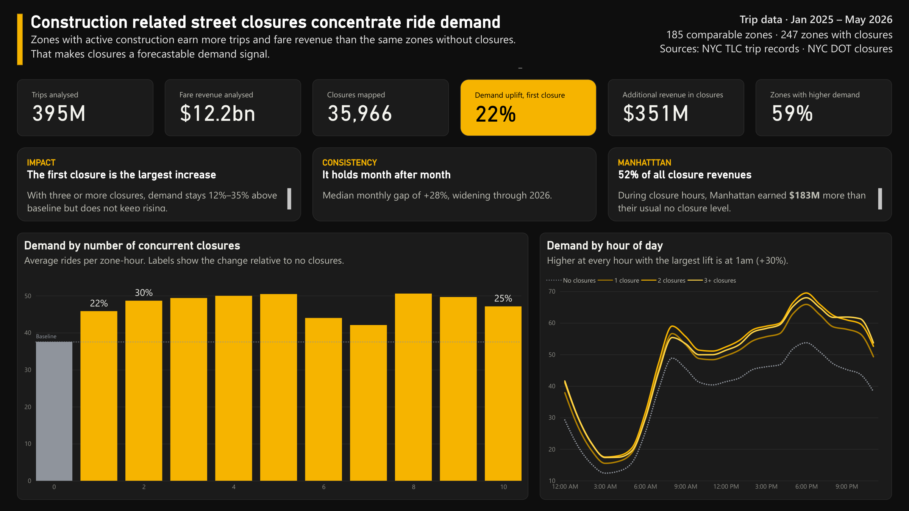
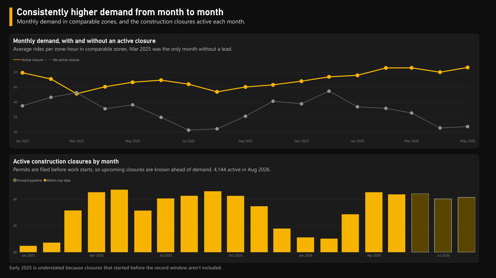
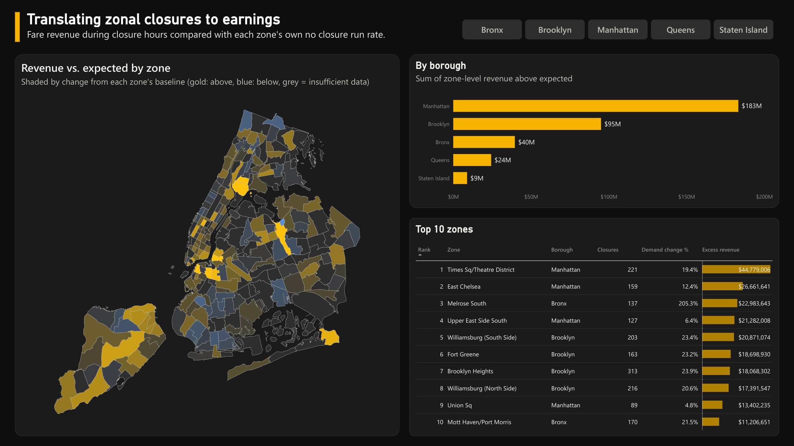
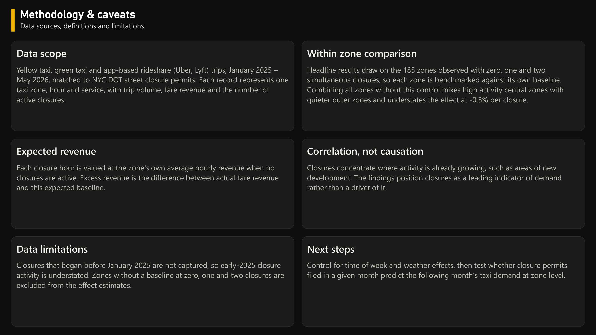

# NYC Taxi Demand and Construction Street Closures

**Does taxi demand go up or down when streets in an area are closed for construction?**

This project joins **395 million NYC taxi and rideshare trips** (January 2025 to May 2026, $12.2B in fares) with **35,966 construction street-closure records** from NYC DOT. It measures how pickup demand in each taxi zone changes as the number of active closures rises. The results are delivered as a four-page Power BI report.

## Power BI report









[View the report as a PDF](report/NYC%20taxi%20closures.pdf) · [Download the Power BI file (.pbix)](report/NYC%20taxi%20closures.pbix)

## Pipeline

```
NYC TLC trip records ─┐
(yellow, green, HVFHV)│   taxi_preprocess.ipynb          analysis.ipynb             export_powerbi.py          build_powerbi_dashboard.py
                      ├─► clean, join, aggregate  ─►  cohort analysis, maps  ─►  star-schema tables   ─►   Power BI data pack
NYC DOT construction  │   to zone × hour × service       revenue estimates       (data/powerbi/)           (data/powerbi_dashboard/)
street closures ──────┘   construction_closures.ipynb
                          map closures to taxi zones
```

1. **Collect.** [`collect_data.ipynb`](notebooks/collect_data.ipynb) downloads monthly TLC trip files for yellow taxis, green taxis and high-volume rideshare (Uber/Lyft) for January 2025 to May 2026. It is adapted from a [MAST30034 template by Oliver Tan](https://github.com/MAST30034-Applied-Data-Science/mast30034-project-1-olivertan1999).
2. **Clean the trips.** [`taxi_preprocess.ipynb`](notebooks/preprocess/taxi_preprocess.ipynb) uses PySpark to standardise the three schemas, remove invalid trips (out-of-range dates, non-positive durations and fares), and aggregate about 400M rows to one row per date × hour × pickup zone × service (`data/processed/pu_agg.parquet`).
3. **Clean the closures.** [`construction_closures.ipynb`](notebooks/preprocess/construction_closures.ipynb) filters the DOT closure records to 2025 onwards and assigns each closure to a TLC taxi zone. It uses a spatial join on the closure geometry, with Census geocoding as a fallback for records that have no geometry (`data/processed/construction_closures.csv`).
4. **Analyse.** [`analysis.ipynb`](notebooks/analysis/analysis.ipynb) uses PySpark and GeoPandas to map demand and closures, compare demand at each number of concurrent closures within a like-for-like cohort, build hourly profiles, measure each zone's change against its own baseline, and estimate revenue impact.
5. **Model.** [`pandas.ipynb`](notebooks/models/pandas.ipynb) uses scikit-learn to predict average trip duration with linear regression and a random forest on a log-transformed target, using a time-based train/test split, and extracts the construction-closure coefficient.
6. **Report.** [`export_powerbi.py`](scripts/export_powerbi.py) exports the analysis as a star schema (fact and dimension tables) to `data/powerbi/`. [`build_powerbi_dashboard.py`](scripts/build_powerbi_dashboard.py) turns those tables into the Power BI data pack and the theme. Colours, fonts, page layout and on-canvas text all live in [`powerbi_style.py`](scripts/powerbi_style.py).

## Repository structure

```
.
├── README.md
├── LICENSE
├── requirements.txt
├── report/
│   ├── NYC taxi closures.pbix           # Power BI report file
│   └── NYC taxi closures.pdf            # PDF export of the report
├── images/
│   └── powerbi_page1–4.png              # report page previews used in this README
├── notebooks/
│   ├── collect_data.ipynb               # download TLC trip data
│   ├── preprocess/
│   │   ├── taxi_preprocess.ipynb        # clean + aggregate trips (PySpark)
│   │   └── construction_closures.ipynb  # clean closures, map to taxi zones
│   ├── analysis/
│   │   └── analysis.ipynb               # main analysis, maps and charts
│   └── models/
│       └── pandas.ipynb                 # linear regression vs random forest
├── scripts/
│   ├── export_powerbi.py                # processed data → star-schema tables (data/powerbi/)
│   ├── build_powerbi_dashboard.py       # star schema → Power BI pack (data/powerbi_dashboard/)
│   └── powerbi_style.py                 # shared palette, fonts, page layout and report copy
└── data/
    ├── street_closures_construction.csv # NYC DOT closures (downloaded manually)
    ├── taxi_zones/                      # TLC taxi zone shapefile (.shp/.dbf/.shx/...) + taxi+_zone_lookup.csv
    ├── raw/tlc_data/                    # yellow/, green/, high_volume/ monthly trip files (YYYY-MM.parquet)
    ├── processed/                       # pu_agg.parquet, pu_agg.csv, construction_closures.csv
    ├── powerbi/                         # star-schema tables, fact_demand.parquet, taxi_zones.geojson (generated)
    └── powerbi_dashboard/               # Power BI data pack (generated):
        ├── 01_kpi_cards.csv             #   page 1 KPI cards
        ├── 02_demand_by_closures.csv    #   demand by number of concurrent closures
        ├── 03_hourly_profile.csv        #   demand by hour of day
        ├── 04_monthly_gap.csv           #   monthly demand, with vs without a closure
        ├── 05_closure_pipeline.csv      #   active closures by month
        ├── 06_zone_map.csv              #   revenue vs expected by zone (map)
        ├── 07_borough_summary.csv       #   revenue above expected by borough
        ├── 08_top_zones.csv             #   top 10 zones table
        ├── dim_borough.csv              #   borough slicer
        ├── nyc_taxi_zones.topojson      #   zone shapes for the map visual
        └── investor_theme.json          #   Power BI theme
```

Only `report/`, `images/`, `data/taxi_zones/` and `data/powerbi_dashboard/` are included in the repository. The raw and intermediate data (about 25 GB) is not, and you can rebuild it with the steps below.

## Running it

Requirements: Python 3.11 and Java 8 or later (for PySpark).

```bash
pip install -r requirements.txt
```

1. Run `notebooks/collect_data.ipynb`. It downloads the trip data to `data/raw/tlc_data/`. Download the [Street Closures due to Construction Activities](https://data.cityofnewyork.us/Transportation/Street-Closures-due-to-Construction-Activities-by-/i6b5-j7bu/about_data) dataset from NYC Open Data and save it as `data/street_closures_construction.csv`.
2. Run the two notebooks in `notebooks/preprocess/`. They write to `data/processed/`.
3. Run `notebooks/analysis/analysis.ipynb` and `notebooks/models/pandas.ipynb`.
4. Build the Power BI pack:
   ```bash
   python scripts/export_powerbi.py
   python scripts/build_powerbi_dashboard.py
   ```
5. Open `report/NYC taxi closures.pbix` in Power BI Desktop. To refresh it with your own build, set the `DataFolder` parameter (Transform data → Edit parameters) to the full path of your `data/powerbi_dashboard/` folder, ending in a backslash. To build the report from scratch instead, load the CSVs in `data/powerbi_dashboard/` and apply `investor_theme.json`.

## Data sources

- [NYC TLC Trip Record Data](https://www.nyc.gov/site/tlc/about/tlc-trip-record-data.page): yellow, green and high-volume for-hire vehicle trips
- [NYC DOT Street Closures due to Construction Activities](https://data.cityofnewyork.us/Transportation/Street-Closures-due-to-Construction-Activities-by-/i6b5-j7bu/about_data) (NYC Open Data)
- [NYC TLC Taxi Zones](https://www.nyc.gov/site/tlc/about/tlc-trip-record-data.page): zone shapefile and lookup table

## License

Released under the [MIT License](LICENSE).
